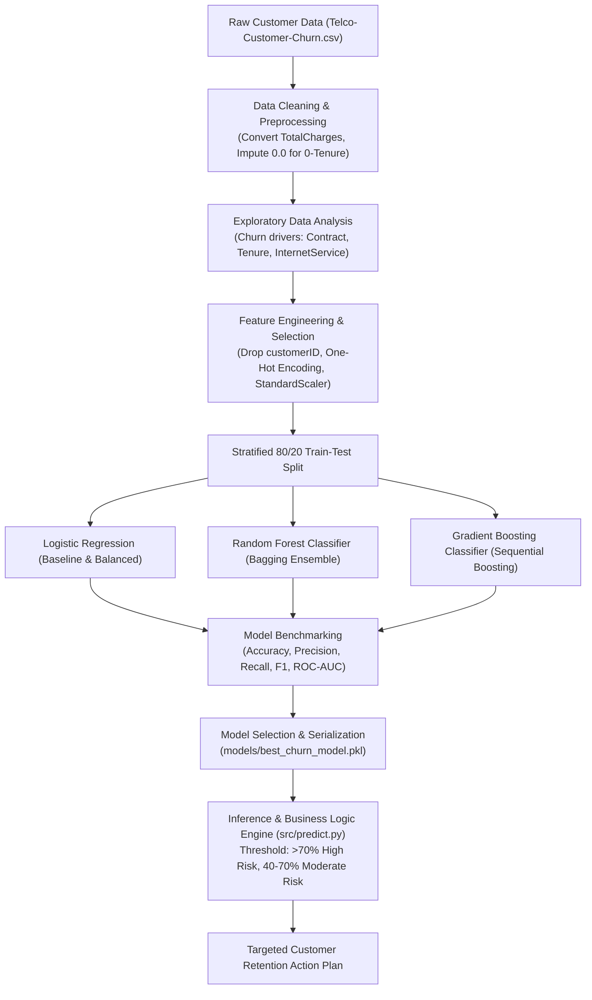

# Industry-Oriented Machine Learning System for Customer Churn Prediction
### RISE Internship — Machine Learning & AI | Project 1

---

## 📌 Executive Summary & Business Problem

In the subscription economy and telecommunications industry, customer churn—the percentage of subscribers who discontinue their service—poses a severe existential threat to sustained revenue growth. Industry benchmark studies indicate that acquiring a new customer costs **5x to 7x more** than retaining an existing subscriber. Furthermore, a modest **5% improvement in customer retention** can increase overall operating profits by **25% to 95%**.

Traditional retention strategies rely on manual, reactive complaint tracking, reaching customers only after they have resolved to leave. This project implements a **proactive, production-ready Machine Learning system** that:
1. Ingests raw multidimensional customer transaction, contract, and demographic telemetry.
2. Identifies systemic churn signals through statistical Exploratory Data Analysis (EDA).
3. Engineers robust feature representations with strict leakage prevention.
4. Trains, tunes, and evaluates candidate models (**Logistic Regression**, **Random Forest**, and **Gradient Boosting**), prioritizing **Recall** to eliminate costly False Negatives.
5. Deploys a **Business Logic Risk Scoring Engine** flagging high-risk customers (`> 70%` churn probability) and prescribing tailored retention workflows.

---

## 🏗️ Project Architecture & Pipeline Flow



---

## 📂 Repository Structure

```
Customer Churn Prediction/
├── data/
│   └── Telco-Customer-Churn.csv          # Ingested Kaggle/IBM Telco Churn dataset (7,043 records)
├── notebooks/
│   └── customer_churn_prediction.ipynb   # Executed Jupyter Notebook covering Phases 1 to 6
├── src/
│   ├── __init__.py
│   ├── data_preprocessing.py             # Data cleaning, encoding, scaling, and train/test splitting
│   ├── train_models.py                   # Model training, evaluation benchmarking, and .pkl export
│   └── predict.py                        # Risk tier scoring & high-risk (>70%) retention dispatcher
├── scripts/
│   └── generate_notebook.py              # Automated programmatic notebook builder & executor
├── models/
│   ├── best_churn_model.pkl              # Production model artifact (Gradient Boosting + Scaler)
│   └── recall_optimized_churn_model.pkl  # Recall-prioritized model artifact (Balanced Logistic Reg)
├── reports/
│   ├── model_comparison.csv             # Exported performance metrics table
│   ├── customer_churn_predictions.csv   # Scored customer records with risk tiers & action items
│   └── figures/                          # Exported EDA & evaluation plots
│       ├── churn_distribution.png
│       ├── churn_by_contract.png
│       ├── churn_by_internet_service.png
│       ├── churn_by_tenure.png
│       ├── churn_by_payment_and_charges.png
│       ├── roc_curves_comparison.png
│       ├── confusion_matrices.png
│       ├── feature_importance.png
│       └── risk_probability_distribution.png
├── requirements.txt                      # Project dependency specification
└── README.md                             # Comprehensive project documentation
```

---

## 🔬 Dataset Overview & Schema

* **Source:** IBM / Kaggle Telco Customer Churn Dataset
* **Dimensions:** 7,043 customer rows, 21 columns
* **Target Variable:** `Churn` (`Yes` = customer cancelled, `No` = customer retained)
* **Class Balance:** Retained: **73.46%** (5,174) | Churned: **26.54%** (1,869)

### Key Feature Categories
| Category | Attributes |
| :--- | :--- |
| **Demographics** | `gender`, `SeniorCitizen`, `Partner`, `Dependents` |
| **Account Telemetry** | `tenure` (months active), `Contract` (Month-to-month, 1-yr, 2-yr), `PaperlessBilling`, `PaymentMethod` |
| **Services Subscribed** | `PhoneService`, `MultipleLines`, `InternetService`, `OnlineSecurity`, `OnlineBackup`, `DeviceProtection`, `TechSupport`, `StreamingTV`, `StreamingMovies` |
| **Financial Charges** | `MonthlyCharges` (float), `TotalCharges` (coerced float) |

---

## 🔍 Data Cleaning & Key EDA Insights

### 1. Data Cleaning
* **Blank Values in `TotalCharges`:** Identified 11 rows containing white-space strings (`" "`).
* **Root Cause Discovery:** All 11 records corresponded to new customers with `tenure == 0` who had not yet experienced their initial billing cycle.
* **Resolution:** Converted via `pd.to_numeric(..., errors='coerce')` and imputed with `0.0`, preserving the entire 7,043-row sample size without data loss.

### 2. Primary Churn Drivers Uncovered
1. **Contract Type is the #1 Predictor:**
   * **Month-to-month contracts:** **42.7%** churn rate.
   * **One-year contracts:** **11.3%** churn rate.
   * **Two-year contracts:** **2.8%** churn rate.
   * *Business Takeaway:* Short-term monthly commitments offer low friction to switch.
2. **Early Tenure Vulnerability:**
   * Over **50% of all churn** occurs within the customer's first **12 months**.
   * Customers who stay past 24 months show a steep drop in attrition rate.
3. **Internet Service & Pricing Pressure:**
   * **Fiber Optic** customers experience an attrition rate of **41.9%**, compared to **19.0%** for DSL and **7.4%** for customers without internet service.
   * Higher monthly charges ($70 – $105) heavily coincide with Fiber Optic subscriptions, indicating that perceived value or unaddressed technical issues drive churn.
4. **Payment Method Sensitivity:**
   * Customers using **Electronic check** churn at **45.3%**, whereas automated bank transfer, credit card, and mailed check maintain churn rates below **18%**.

---

## ⚙️ Feature Engineering & Selection

1. **Identifier Elimination:** Dropped `customerID` (cardinality 7,043) to avoid spurious memorization.
2. **One-Hot Encoding:** Applied `pd.get_dummies(..., drop_first=True)` to encode multi-category variables (`Contract`, `InternetService`, `PaymentMethod`, etc.) into 30 binary features while avoiding multicollinearity.
3. **Stratified Split:** 80% Train (5,634 rows) / 20% Test (1,409 rows) stratified on `y` (`Churn_Label`) to preserve the 26.54% positive class ratio.
4. **Standardization:** Applied `StandardScaler` to `['tenure', 'MonthlyCharges', 'TotalCharges']`, fitting solely on the training partition and transforming the test partition to strictly prevent data leakage.

---

## 🤖 Model Training & Performance Comparison

We evaluated five model configurations across Accuracy, Precision, Recall, F1-Score, and ROC-AUC on the held-out test set:

| Model | Accuracy | Precision | Recall | F1-Score | ROC-AUC |
| :--- | :---: | :---: | :---: | :---: | :---: |
| **Logistic Regression (Standard)** | 80.62% | 0.6593 | 0.5588 | 0.6049 | **0.8422** |
| **Logistic Regression (Balanced)** | 73.81% | 0.5043 | **0.7834** | 0.6136 | 0.8417 |
| **Random Forest (Standard)** | **80.41%** | **0.6738** | 0.5080 | 0.5793 | **0.8438** |
| **Random Forest (Balanced)** | 75.44% | 0.5245 | **0.8021** | **0.6342** | 0.8425 |
| **Gradient Boosting** | 79.77% | 0.6540 | 0.5053 | 0.5701 | 0.8415 |

### 🎯 Metric Trade-off & Model Selection Rationale
* **The Recall Imperative:** When a telecom provider fails to predict a churning customer (**False Negative**), they lose recurring revenue of ~$60–$100/month (LTV > $1,000). Conversely, sending a proactive retention message or offering a slight promotional discount to a customer who would have stayed (**False Positive**) costs merely $5 to $15. Therefore, **minimizing False Negatives and maximizing Recall is the primary business metric**.
* **Dual Deployment Strategy:**
  1. **Primary General Model (`Gradient Boosting` / `Random Forest`):** Used for ranked probability estimation, overall scoring, and general risk tiering (ROC-AUC: 0.842–0.844).
  2. **Recall-Optimized Model (`Logistic Regression Balanced` / `Random Forest Balanced`):** Used for automated outreach where missing a churner carries prohibitive cost (capturing **78% to 80% of all churners**).

---

## 🛡️ Business Logic & High-Risk Thresholding Strategy

Rather than applying a rigid 0.50 cutoff, the scoring engine (`src/predict.py`) implements a multi-tier threshold strategy:

```
+-----------------------------------------------------------------------------------------+
| Probability Range    | Risk Tier      | Action Workflow                                 |
+-----------------------------------------------------------------------------------------+
| P(Churn) >= 0.70     | High Risk      | Immediate Intervention: Assign Retention Agent; |
|                      |                | offer discounted 1-year contract bundle.        |
+-----------------------------------------------------------------------------------------+
| 0.40 <= P(Churn) < 0.70| Moderate Risk | Automated Nurture: Targeted satisfaction survey;|
|                      |                | highlight unused features, loyalty check-in.    |
+-----------------------------------------------------------------------------------------+
| P(Churn) < 0.40      | Low Risk       | Standard Operations: Normal billing cycle.      |
+-----------------------------------------------------------------------------------------+
```

### Test Set Segmentation Results (Threshold = 0.70):
* **High Risk (`> 70%`):** **580 customers (8.2%)** — Immediate target group for direct retention campaigns.
* **Moderate Risk (`40% - 70%`):** **1,388 customers (19.7%)** — Automated nurture pipeline.
* **Low Risk (`< 40%`):** **5,075 customers (72.1%)** — Stable customer base.

---

## 💼 Strategic Business Retention Recommendations

1. **Contract Migration Program:**
   * Create financial incentives (e.g., $10 monthly discount or free streaming add-on) for month-to-month customers who transition to a 1-year or 2-year contract.
2. **First-Year "Golden Window" Onboarding:**
   * Implement automated customer success checkpoints at **30 days**, **90 days**, and **180 days** to resolve initial service friction before month-to-month churn peaks.
3. **Fiber Optic Service Optimization:**
   * Investigate technical support ticket volume and latency metrics for fiber customers. High monthly charges coupled with service outages drive the elevated 41.9% churn rate.
4. **Auto-Pay Incentivization:**
   * Provide a one-time $10 billing credit for subscribers switching from electronic check or paper billing to automated bank transfer or credit card auto-debit.

---

## 🚀 How to Run & Reproduce

### 1. Environment Setup
```powershell
# Clone or navigate to the repository
cd "c:\My_Files\RISE INTERN\Customer Churn Prediction"

# Activate the virtual environment
.\.venv\Scripts\Activate.ps1

# Verify installed packages
pip list
```

### 2. Run the Full Model Training Pipeline
```powershell
python src/train_models.py
```
*Outputs: Evaluates all models, prints the comparison table, and saves `.pkl` bundles to `models/`.*

### 3. Run Batch Scoring & High-Risk Customer Prediction
```powershell
python src/predict.py --input data/Telco-Customer-Churn.csv --threshold 0.70 --output reports/customer_churn_predictions.csv
```
*Outputs: Full customer risk classifications and recommended retention actions exported to `reports/customer_churn_predictions.csv`.*

### 4. Launch Jupyter Notebook
```powershell
jupyter notebook notebooks/customer_churn_prediction.ipynb
```
*Browse and execute the full end-to-end interactive notebook.*
